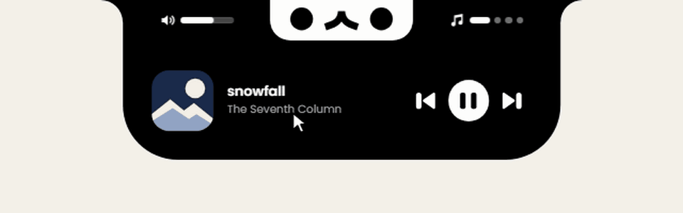
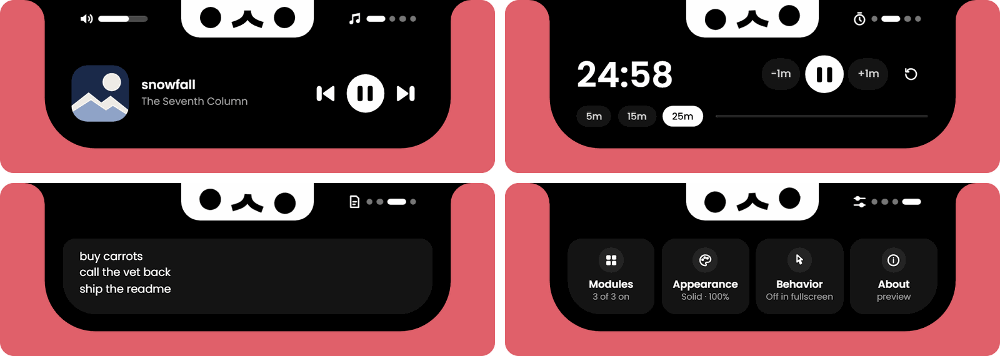
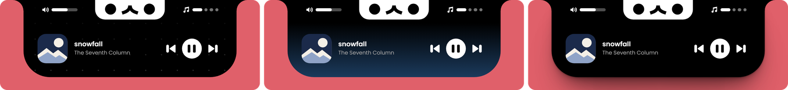
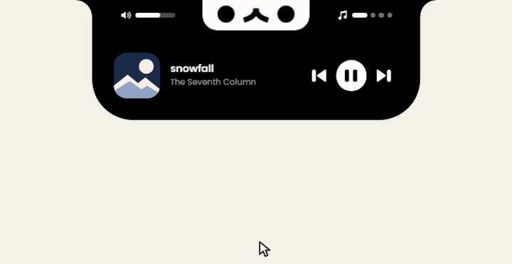
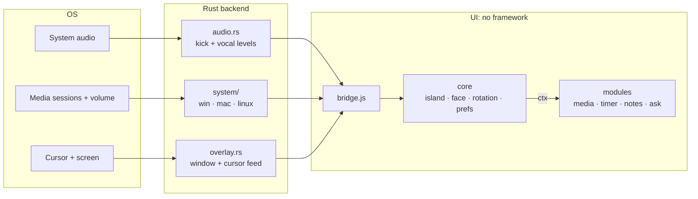

<h1 align="center">usagi</h1>

<p align="center">
  <strong>A tiny rabbit who lives in the top edge of your screen.</strong><br>
  A desktop companion and a home for small utilities, merged into the screen edge like a dynamic island.
</p>

<p align="center">
  <a href="https://github.com/tino767/usagi/actions/workflows/ci.yml"></a>
  
  
  
  
</p>

<p align="center">
  
</p>

usagi sleeps as a small pill at the top of your screen. Bring the cursor close and
he peeks out. Click his face and he opens into a panel of utilities; scroll to move
between them, click his face again to close.

The island has no window chrome and no visible seam: it reads as the screen edge
growing a face. He bobs to the kick drum of whatever you're playing, nods when you
do something, and shakes his head when you scroll past the end of the list.

(*Usagi*, うさぎ, is Japanese for rabbit.)

| 1.35&nbsp;MB | 0 | ~4,200 |
|:---:|:---:|:---:|
| Windows installer (`usagi.exe` is 3.7&nbsp;MB) | JavaScript dependencies at runtime: no framework, no bundler | lines of JS, CSS and Rust, across three OS backends |

## What's inside

<p align="center">
  
</p>

- **Media:** now playing, transport controls and system volume for whatever's playing.
- **Timer:** presets and ±1 minute steps. Close the island and the pill becomes its progress bar.
- **Notes:** a scratchpad that's always one click away.
- **Settings:** a searchable module grid, appearance, behavior, and reset controls for each page.

<p align="center">
  
</p>

Backgrounds come in solid, dot matrix (which can pulse on the kick), gradient and
live frosted glass. The face can slide away when idle, leaving just the content.

### There's a rabbit up there

Everything so far is the part of him that fits on screen. Grab his face and pull.

<p align="center">
  
</p>

## Design details

usagi is mostly an exercise in sweating small things. A few I'm fond of:

- **It has to merge with the screen.** The top corners are concave fillets, not rounded corners, and each is capped at `height − radius` so it meets the bottom curve flush at every size. The ears overlap the island by one unit so no hairline seam shows at fractional pixels.
- **Everything is concentric.** The content inset is 22px on the sides and bottom, so content corners run at `64 − 22 = 42px` inside the island's 64px curve. Settings ends each page in a full-width reset tile shaped to fill that curve, so no real row ever gets clipped by it.
- **The face is the close button.** Peek and open share the same 168×48 footprint, so opening swaps one face for the other in place, and there's nothing extra to learn or aim for.
- **Dead ends are in character.** The list stops at both ends instead of looping. Scrolling past one nudges the content toward the wall and back, and usagi shakes his head once per gesture, however many wheel events that gesture produced.
- **Light comes from above.** The drop shadow is layered `box-shadow`s, each reaching further with a negative spread, so it falls below the island and never touches the sides or ears where it would break the merge.
- **White text stays readable.** Custom gradient colors are capped at luminance 0.08 (about 7:1 contrast), and the glass veil darkens over bright backdrops.
- **Accessible by default.** Island transitions, page changes and the spring all respect `prefers-reduced-motion`, and icon-only controls carry `aria-label`s.

## Under the hood

**Click-through that still knows where you are.** The overlay is a transparent,
always-on-top window that ignores the mouse, so everything around the island stays
clickable. But a window that ignores the mouse can't see it. So the backend polls the
cursor every 50ms and streams it to the UI, which hit-tests against the island and
turns the window interactive only while the cursor is over it.

**Beat detection without an FFT.** A capture thread reads system audio (WASAPI
loopback, a Core Audio tap, or `parec`) and analyzes it in 5ms hops with one-pole
filters. The kick is an *onset* detector: the low end jumping above its own recent
average, so a sustained bass line doesn't count, only the hit. Rates are per-hop so
it feels the same at any sample rate, a decaying auto-gain copes with quiet tracks,
and levels reach the UI thread through lock-free atomics at about 60Hz.
([`audio.rs`](src-tauri/src/audio.rs))

**Real glass, in a webview that can't see the desktop.** `backdrop-filter` has nothing
to blur behind a transparent window. So on Windows the backend uses DXGI Desktop
Duplication to copy the screen behind the island at 1/3 size, only when it changes,
and streams raw frames to a canvas over a binary channel for CSS to blur. The catch is
that the copy would contain the island itself, so usagi excludes its own window from
screen capture while glass is on. Where that isn't possible it degrades to a plain
smoked veil. ([`win.rs`](src-tauri/src/system/win.rs),
[`glass.js`](ui/core/glass.js))

**Physics with no animation library.** Dragging him follows
`y = K · ln(1 + d/K)`: 1:1 at first, then more and more tension, but it never stops
giving. The release is a closed-form damped spring (ω = 18 rad/s, ζ = 0.32) evaluated
each frame from elapsed time, not integrated step by step, so it can't drift or
explode on a slow frame. His face, ears and the island all ride that one value.
([`island.js`](ui/core/island.js))

**Reactions are blended, not played.** Modules never draw the face. They request
reactions (`nod`, `shake`, `tilt`, `sing`…) and the core composites them each frame
with the audio bob and idle blinks, so any number of modules can ask at once without
fighting. While a module has him summoned, his face belongs to it alone.
([`face.js`](ui/core/face.js))

**Staying on top of everything.** On Windows he re-claims the topmost spot every
second, since other always-on-top apps can push him down, and hides over fullscreen
games and presentations. On macOS he sits above the menu bar at
`NSPopUpMenuWindowLevel`, so on a notched Mac he lines up with the notch, and follows
you across Spaces and fullscreen apps.

### Architecture



The backend exposes the same functions on all three platforms, gated with `#[cfg]`.
Modules talk to the core only through the `ctx` object, and in a plain browser
`bridge.js` swaps in a mock, which is how the UI gets designed without launching the
app. A module that fails is contained: its page shows an error and the rest keep working.

## How it was built

usagi is a product of agentic engineering. I designed it by hand, led the product and
technical decisions, and fine-tuned the result, with
[Claude Code](https://claude.com/claude-code) as my implementation partner.

[`CLAUDE.md`](CLAUDE.md) is the actual working brief: the design rules, proportions and
behaviors the project is held to. If you're curious how that collaboration works in
practice, that file and the commit history are the honest record.

## Run it

The quickest look is the UI on its own in a browser, with fake media and a mock OS
bridge. It only needs [Node 18+](https://nodejs.org):

```bash
git clone https://github.com/tino767/usagi.git && cd usagi
npm install
npm run preview   # http://localhost:5179
```

The full app needs [Rust](https://rustup.rs) and your platform's prerequisites:

- **Windows:** Visual Studio Build Tools with "Desktop development with C++". WebView2 ships with Windows 11.
- **macOS:** `xcode-select --install`
- **Linux (Debian/Ubuntu):** `sudo apt install libwebkit2gtk-4.1-dev libayatana-appindicator3-dev librsvg2-dev libxdo-dev build-essential pulseaudio-utils`

```bash
npm run dev       # run the app (the first build takes a few minutes)
npm run build     # installers, in src-tauri/target/release/bundle/
```

`Ctrl+Alt+U` (`Cmd+Option+U` on macOS) toggles usagi open. The tray icon has Open,
Reload and Quit; everything else is in Settings, the last page.

<details>
<summary><strong>Project layout</strong></summary>

```
ui/                        everything you see, no build step
  core/                    the framework
    island.js              inactive / welcome / open, hit-testing, the pull physics
    face.js                the face and reaction blending
    rotation.js            module list, scroll-to-switch, position rail
    settings.js            the built-in Settings page (always last)
    prefs.js               user preferences and their defaults
    glass.js               the frosted glass background
    bridge.js              talks to the Rust backend (mock-bridge.js in preview)
    audio.js               kick + vocal levels, with a fake fallback
    store.js               per-module persistent storage
    dom.js  icons.js       tiny DOM helpers, shared glyphs
    app.js                 boot
  modules/
    media/  timer/  notes/  ask/
    _template/             copy this to start a new module
src-tauri/                 Rust backend
  src/main.rs              commands, tray, plugins
  src/overlay.rs           placement, click-through, cursor feed, stay-on-top, fullscreen hiding
  src/audio.rs             kick + vocal detection from system audio
  src/system/              media + volume per OS: win.rs, mac.rs, linux.rs
scripts/
  gen-modules.js           writes ui/modules/index.json (runs before dev/build)
  preview.js               browser preview server
```

</details>

<details>
<summary><strong>Writing a module</strong></summary>

usagi is a platform: everything but Settings is a module, and a new one is one folder.

1. Copy `ui/modules/_template` to `ui/modules/<id>`.
2. Set `id` in `index.js` to the folder name, give it a `name` and `icon`.
3. Restart `npm run dev`, open **Settings › Modules** and click it to add it.

```js
export default {
  id: 'pomodoro',
  name: 'Pomodoro',
  description: 'Focus sessions',  // tooltip and search text in Settings › Modules
  icon: icons.timer,              // 24×24 SVG string in currentColor
  order: 4,                       // default position on first run
  styles: true,                   // load ./style.css

  create(ctx) {                   // once, when it joins the rotation; keeps running in the background
    return { el, rail, show() {}, hide() {}, destroy() {} };
  },
};
```

Every module gets the same 468×96 content area and can't resize the island, which
keeps the rotation feeling like one object.

| `ctx` | |
|---|---|
| `h(tag, props, ...children)` | DOM helper |
| `icons` | shared glyphs |
| `face.bounce(ms)` / `nod(ms, depth)` / `shake(ms)` / `tilt(deg)` / `sing(ms)` / `blink(times)` / `think(ms)` | reactions |
| `island.attention(ms)` | peek out even when the cursor is away |
| `island.status(text)` | short text in place of the collapsed pill (`null` clears) |
| `island.progress(0..1)` | turn the collapsed pill into a progress bar (`null` clears) |
| `island.isFront()` / `open()` / `close()` | visibility and control |
| `system.media` / `system.volume` | OS bridge |
| `audio.kick` / `audio.vocal` | current 0..1 kick and vocal levels |
| `store.get(key, fallback)` / `set(key, value)` | persisted, scoped to the module |

Shared CSS: `.btn-round`, `.btn-ghost`, `.chip`, `.eyebrow`, `.hslider`. Tokens are at
the top of `ui/core/styles.css`.

A module that needs something new from the OS: add a `#[tauri::command]` in
`src-tauri/src/main.rs`, implement it in each of `win.rs`, `mac.rs` and `linux.rs`,
call it from `ui/core/bridge.js`, and pass it through `ctx.system` in `app.js`.

</details>

## Platform support

| | Windows 10/11 | macOS 12+ | Linux (X11) |
|---|---|---|---|
| Now playing + controls | Any app in the media flyout | Spotify, Apple Music | Any MPRIS player |
| Album art | ✓ | Spotify | ✓ |
| System volume | Core Audio | `osascript` | `wpctl` / `pactl` |
| Music reaction | WASAPI loopback | Core Audio tap (14.2+, asks permission) | `parec` on the sink monitor |
| Glass background | ✓ | smoked veil | smoked veil |
| Hide over fullscreen apps | ✓ | not yet | not yet |

- **macOS:** Apple locked the system-wide "now playing" API to its own apps in macOS 15.4, so usagi talks to Spotify and Music directly. The first time, macOS asks to let usagi control each app, and to listen to system audio for the music reaction.
- **Linux:** Wayland doesn't let apps place themselves or stay on top, so usagi runs through XWayland automatically. Transparency needs a compositor (any modern desktop has one).
- **Displays:** usagi sits on the primary display.

## Status

Version 0.2.0, in active development. It runs on Windows and Linux. macOS is
type-checked but hasn't been run on real hardware yet, so expect small fixes the first
time you build there.

## License

Proprietary. Copyright (c) 2026 Valentino Valero. All rights reserved. The source is
public so you can read how usagi is built; it isn't open source, and the code, artwork
and character aren't licensed for reuse. See [LICENSE](LICENSE).
